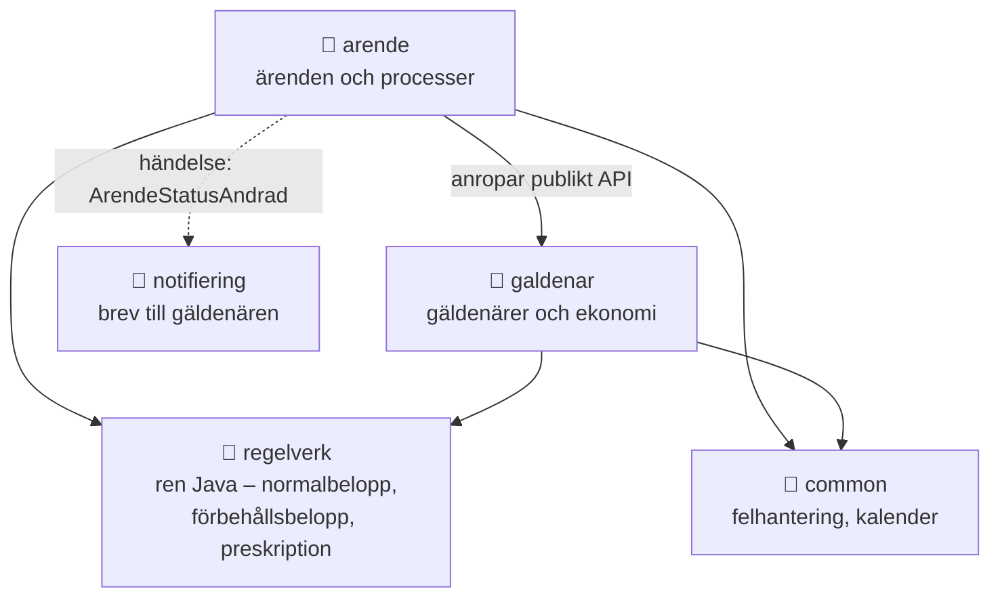
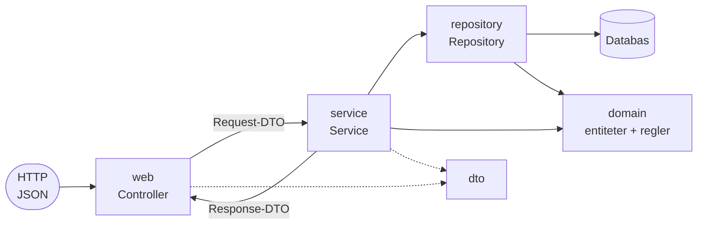

# Skuldhandläggning ⚖️

Ett handläggningssystem för skuldärenden, inspirerat av hur **Kronofogden** arbetar.
Byggt för att vara **enkelt att läsa** och visa **modern arkitektur** med Java 25 och Spring Boot 4.

> ⚠️ Det här är ett lärprojekt. Det har ingen koppling till Kronofogdemyndigheten och reglerna är
> förenklade (se [Förenklingar](#förenklingar)). Alla personer och personnummer i exempeldatan är påhittade.

| Teknik | Version |
|---|---|
| Java | 25 |
| Spring Boot / Framework | 4.1 / 7.0 |
| Spring Modulith | 2.1 |
| Hibernate | 7 |
| Databas | H2 + Flyway |

---

## Innehåll

1. [Kom igång](#kom-igång)
2. [Domänen: vad gör Kronofogden?](#domänen-vad-gör-kronofogden)
3. [Arkitektur](#arkitektur) – och [alla diagram](docs/diagram.md)
4. [Ärendets livscykel](#ärendets-livscykel)
5. [Regelverket i koden](#regelverket-i-koden)
6. [API](#api)
7. [Tester](#tester)
8. [Förenklingar](#förenklingar)
9. [Idéer att bygga vidare på](#idéer-att-bygga-vidare-på)
10. [Ordlista](#ordlista)
11. [Källor](#källor)

---

## Kom igång

Kräver JDK 25 (`sdk env install` om du använder SDKMAN – versionen står i `.sdkmanrc`).

```bash
./mvnw spring-boot:run
```

```bash
./mvnw test
```

Prova API:t med [`requests.http`](requests.http) i IntelliJ/VS Code, eller:

```bash
curl -s localhost:8080/api/galdenarer/2/forbehallsbelopp
```

H2-konsolen: http://localhost:8080/h2-console (JDBC URL `jdbc:h2:mem:handlaggning`, användare `sa`).

---

## Domänen: vad gör Kronofogden?

Kronofogden hjälper den som har pengar att få (**borgenären**) att få betalt av den som är skyldig
(**gäldenären**), och hjälper den som har för stora skulder att komma ur dem.
Systemet hanterar tre typer av ärenden:

### 1. Betalningsföreläggande – fastställa att skulden finns

En privat borgenär (t.ex. ett inkassobolag) ansöker. Kronofogden **delger** gäldenären kravet.
Gäldenären har normalt **10 dagar** på sig att **bestrida** (säga emot).

- **Inget bestridande** → Kronofogden meddelar ett **utslag**. Det har samma verkan som en dom
  och kan *verkställas* (drivas in).
- **Bestridande** → borgenären kan begära att målet **överlämnas till tingsrätten**, som avgör tvisten.

### 2. Utsökning – driva in skulden

| | Allmänt mål | Enskilt mål |
|---|---|---|
| Skulden gäller | Staten: skatt, böter, CSN, parkeringsavgifter | Privata: fakturor, lån |
| Hur det startar | Myndigheten lämnar över skulden direkt | Borgenären ansöker med en exekutionstitel (utslag/dom) |
| Preskription | 5 år efter utgången av det år skulden förföll | 10 år (3 år för konsumentfordringar), börjar om vid avbrott |

Kronofogden **utreder** gäldenärens inkomster och tillgångar och kan besluta om **löneutmätning**:
arbetsgivaren drar en del av lönen. Gäldenären får alltid behålla ett **förbehållsbelopp** att leva på.

### 3. Skuldsanering – en väg ut ur skulderna

För den som inte kan betala sina skulder inom överskådlig tid. Beviljas skuldsanering betalar
personen enligt en plan i **5 år**. Därefter är skulderna som ingick borta.

### Dagbok

Kronofogden ska föra **dagbok** i varje mål. I systemet skrivs varje händelse automatiskt i
ärendets dagbok, som bara kan läggas till i – aldrig ändras.

---

## Arkitektur

> 📊 **Alla diagram finns i [`docs/diagram.md`](docs/diagram.md)**: helhetsbild, moduler, lager,
> processkedjan, statusflöden, klassdiagram, sekvensdiagram och databasen.

### Modulär monolit

Systemet är **en** applikation (enkel att köra och driftsätta) men uppdelad i **moduler** med
tydliga gränser. Varje modul är ett paket. Det är dagens vanligaste rekommendation för nya system:
börja med en modulär monolit, bryt ut mikrotjänster först när det verkligen behövs.

```
se.jtutala.handlaggning
├── regelverk/      Ren Java: normalbelopp, förbehållsbelopp, preskription. Inget Spring.
├── galdenar/       Gäldenärer: personnummer, ekonomi, hushåll
├── arende/         Ärenden: statusflöden, dagbok, inbetalningar (systemets kärna)
├── notifiering/    Brev till gäldenären – lyssnar på händelser från arende
└── common/         Felhantering och klocka (delas av alla)
```



**Regler som Spring Modulith kontrollerar** (`ModulStrukturTest`):

- En modul får bara använda det som ligger **direkt i en annan moduls paket** – dess publika API.
  Allt i underpaketen (`web`, `service`, `domain` …) är internt. Ärendemodulen pratar därför med
  gäldenärsmodulen via interfacet `GaldenarApi`, aldrig via dess services eller entiteter.
- Inga cykliska beroenden. `arende` känner inte till `notifiering` – den publicerar bara en händelse.

Testet genererar också diagram till `target/spring-modulith-docs/`.

### Lagren inuti en modul: controller → service → repository

Varje modul (`arende`, `galdenar`) är uppdelad i samma fem lager. Det publika API:t ligger direkt
i modulens paket.

```
arende/
├── ArendeStatusAndrad, Arendestatus, Arendetyp   ← publikt API (händelsen som andra moduler lyssnar på)
├── web/          *Controller   – HTTP in och ut, @Valid, inget annat
├── dto/          *Request, *Response – records som beskriver API:t
├── service/      *Service      – ett användningsfall per klass, @Transactional, mappning DTO ⇄ domän
├── domain/       entiteter och värdeobjekt – affärsreglerna, inget Spring Web
└── repository/   *Repository   – Spring Data JPA

galdenar/
├── GaldenarApi                                   ← publikt API (används av arende)
├── web/  dto/  service/  domain/  repository/
```



| Lager | Får använda | Får **inte** använda | Namn |
|---|---|---|---|
| `web` | `service`, `dto` | `repository`, `domain` | `*Controller` |
| `service` | `repository`, `domain`, `dto`, andra modulers API | `web` | `*Service` |
| `repository` | `domain` | `service`, `web`, `dto` | `*Repository` (interface) |
| `domain` | bara sig själv, `regelverk`, `common` | allt ovan | fritt, efter domänbegreppen |
| `dto` | inget av lagren | `domain`, `service`, `web` | `*Request`, `*Response` (records) |

Viktiga följder:

- **Entiteter lämnar aldrig service-lagret.** Controllers ser bara DTO:er.
- **Mappningen DTO ⇄ domän sker på ett ställe**, i service-lagret (`ArendeMapper`, `GaldenarMapper`).
  Varken DTO:erna eller domänen känner till varandra.
- **Transaktionen börjar och slutar i servicen** (`@Transactional`). Där hämtas, ändras och sparas data.

Reglerna kontrolleras av **ArchUnit** i [`LagerArkitekturTest`](src/test/java/se/jtutala/handlaggning/LagerArkitekturTest.java).
Skriver någon en controller som anropar ett repository direkt misslyckas bygget:

```
Constructor <...web.FelaktigController.<init>(...repository.ArendeRepository)>
has parameter of type <...repository.ArendeRepository>
```

### Clean code: ett ansvar per klass och metod

Varje klass ska bara ha **en anledning att ändras** (Single Responsibility Principle), och varje
metod ska göra **en sak** – och heta det den gör. Så här är ansvaret fördelat i ärendemodulen:

| Ansvar | Klass |
|---|---|
| Det gemensamma för alla ärenden: status, dagbok, händelser | `Arende` |
| Reglerna för betalningsföreläggande | `Betalningsforelaggande` |
| Reglerna för utsökning | `Utsokningsarende` |
| Reglerna för skuldsanering | `Skuldsaneringsarende` |
| Vilka statusbyten som är tillåtna | `Statusflode` |
| Kravet: borgenär, belopp, förfallodag | `Fordran` |
| 10-dagarsfristen för bestridande | `Bestridandefrist` |
| De 5 åren för skuldsanering | `Skuldsaneringsperiod` |
| Dagbokens anteckningar | `Dagbok` |
| Inbetalningarna och deras summa | `Inbetalningar` |
| Skapa rätt sorts ärende | `ArendeFabrik` |
| Hämta och spara ärenden, kontrollera typ | `ArendeHamtare` |
| DTO ⇄ domän | `ArendeMapper` |
| Användningsfallet *registrera* | `ArendeRegistreringService` |
| Användningsfallet *läsa/arbetslista* | `ArendeSokService` |
| Utredning och avskrivning (alla typer) | `ArendeAtgardService` |
| Användningsfall per process | `BetalningsforelaggandeService`, `UtsokningService`, `SkuldsaneringService` |
| HTTP per process | `ArendeController`, `BetalningsforelaggandeController`, `UtsokningController`, `SkuldsaneringController` |
| Ett kommando eller svar över HTTP | en record per fil: `DelgivningRequest`, `BestridandeRequest`, `ArendeResponse` … |

Samma princip i övriga moduler:

| Modul | Uppdelning |
|---|---|
| `galdenar` | `GaldenarRegistreringService` (skapa), `GaldenarSokService` (läsa), `GaldenarEkonomiService` (ekonomi och förbehållsbelopp), `Ekonomi` (hushållets uppgifter), `Luhn` (kontrollsiffran), `Personnummer` (värdeobjektet), `GaldenarMapper` |
| `notifiering` | `BrevUtskick` (reagera på händelser), `Brevmall` (texten), `Brevlada`/`LoggandeBrevlada` (leveransen) |
| `common` | `Kalender` (dagens datum), `GlobalFelhanterare` (undantag → HTTP), `Problemsvar` (svarsformatet) |

**Metoder:** regler bryts ut till små metoder med namn som förklarar dem, t.ex.

```java
public void bestrid(LocalDate inkomDatum, String grund, LocalDate idag) {
    kontrolleraIntime(inkomDatum);
    bytStatus(BESTRITT, idag, "Bestridande inkom %s. Grund: %s".formatted(inkomDatum, grund));
}
```

och varje användningsfall följer samma tre steg:

```java
@Transactional
public ArendeResponse delge(long id, DelgivningRequest request) {
    Betalningsforelaggande bf = hamta(id);           // 1. hämta via repository
    bf.delge(request.datum(), kalender.idag());      // 2. låt domänobjektet göra jobbet
    return spara(bf);                                // 3. spara och svara med en DTO
}
```

**Polymorfism i stället för typkontroller:** tidigare började många metoder med
"är det här ett betalningsföreläggande?". Nu finns `delge` bara på `Betalningsforelaggande`,
så frågan behövs inte. Att rätt typ hämtas kontrolleras på ett ställe: `ArendeHamtare.hamta(id, typ)`.

### Designval och varför

| Val | Varför | Var |
|---|---|---|
| **Rik domänmodell** | Affärsreglerna ligger i ärendeklasserna, inte utspridda i services. Testbara utan Spring. | `Betalningsforelaggande.java` m.fl. |
| **En klass per ärendetyp** | Varje process har sina egna regler i en egen klass; JPA lagrar dem i samma tabell (`SINGLE_TABLE`). | `Arende` + subklasser |
| **Tillståndsmaskin per typ** | Vilka statusbyten som är tillåtna står i ett `Statusflode` i respektive ärendeklass. | `Statusflode.java` |
| **Task-based API** | En endpoint per åtgärd (`/bestridande`, `/utslag`) i stället för "sätt status". Servern äger reglerna. | `ArendeController` |
| **Värdeobjekt** | `Personnummer` kan inte finnas i ogiltigt skick (Luhn, datum). | `Personnummer.java` |
| **Domänhändelser** | `ArendeStatusAndrad` publiceras automatiskt när ärendet sparas (`AbstractAggregateRoot`). | `Arende`, `BrevUtskick` |
| **Referens med id mellan moduler** | `Arende` har `galdenarId`, inte ett `Galdenar`-objekt. Ingen foreign key mellan modulernas tabeller. | `V1__schema.sql` |
| **Injicerad `Clock`** | Frister och preskription beror på "idag". Testerna styr datumet. | `KlockKonfiguration` |
| **Problem Details (RFC 9457)** | Standardiserade felsvar med begripliga meddelanden. | `GlobalFelhanterare` |
| **DTO:er som records** | API-kontraktet skilt från databasen. | `dto/` |
| **Lager per modul** | controller → service → repository, kontrollerat av ArchUnit. | `LagerArkitekturTest` |
| **Flyway** | Versionshanterat databasschema. | `db/migration` |
| **Optimistisk låsning** | `@Version` – två handläggare kan inte skriva över varandra. | entiteterna |
| **Asynkrona händelselyssnare** | Brev skickas efter commit, utan att handläggaren väntar. | `@ApplicationModuleListener` |
| **Virtuella trådar** | `spring.threads.virtual.enabled=true` | `application.properties` |

### Integritet (GDPR)

Personnummer är känsliga personuppgifter:

- `Personnummer.toString()` maskerar numret (`19850315-****`) så det inte läcker till loggar.
- Sökning sker med `POST /api/galdenarer/sok` – personnumret i en URL hamnar i serverloggar och historik.
- Ett riktigt system behöver dessutom inloggning, behörigheter per handläggare och loggning av vem som läst vad.

---

## Ärendets livscykel

Statusflödena definieras som konstanten `FLODE` i respektive ärendeklass:
[`Betalningsforelaggande`](src/main/java/se/jtutala/handlaggning/arende/Betalningsforelaggande.java),
[`Utsokningsarende`](src/main/java/se/jtutala/handlaggning/arende/Utsokningsarende.java) och
[`Skuldsaneringsarende`](src/main/java/se/jtutala/handlaggning/arende/Skuldsaneringsarende.java).

**Betalningsföreläggande**
```
REGISTRERAT ─▶ DELGIVET ─┬─▶ UTSLAG_MEDDELAT ──(verkställighet)──▶ nytt UTSÖKNINGS-ärende
                         └─▶ BESTRITT ─┬─▶ OVERLAMNAT_TILL_TINGSRATT
                                       └─▶ AVSKRIVET
```

**Utsökning**
```
REGISTRERAT ─▶ UTREDNING ─▶ LONEUTMATNING ─▶ BETALT
     (alla aktiva steg kan också gå till BETALT, PRESKRIBERAT eller AVSKRIVET)
```

**Skuldsanering**
```
REGISTRERAT ─▶ UTREDNING ─┬─▶ SKULDSANERING_PAGAR ──(5 år)──▶ SKULDSANERING_SLUTFORD
                          └─▶ SKULDSANERING_AVSLAG
```

Exempel på regler som kontrolleras i ärendeklasserna:

| Regel | Fel om den bryts |
|---|---|
| Skulden måste ha förfallit | "Skulden har inte förfallit till betalning ännu" |
| Bestridande senast 10 dagar efter delgivning | "Bestridandet kom in 2026-01-20, efter fristen 2026-01-15" |
| Utslag först efter fristen | "Utslag kan meddelas först när bestridandefristen … har gått ut" |
| Verkställighet kräver utslag | "Verkställighet kräver ett meddelat utslag" |
| Löneutmätning kräver inkomst över förbehållsbeloppet | "Gäldenärens inkomst understiger förbehållsbeloppet" |
| Inbetalning får inte överstiga skulden | "Inbetalningen … är större än kvarstående skuld" |
| Skuldsanering kan slutföras först efter 5 år | "Skuldsaneringen pågår till …" |
| Allmänna mål behöver inget betalningsföreläggande | "Allmänna mål … lämnas direkt för indrivning" |

---

## Regelverket i koden

### Förbehållsbelopp ([`Forbehallsbelopp.java`](src/main/java/se/jtutala/handlaggning/regelverk/Forbehallsbelopp.java))

```
förbehållsbelopp      = normalbelopp + boendekostnad
utmätningsbart belopp = nettolön − förbehållsbelopp     (aldrig under 0, hela kronor)
```

**Normalbelopp 2026** (Kronofogdens föreskrift KFMFS 2025:1):

| Kategori | kr/månad |
|---|---:|
| Ensamstående | 6 243 |
| Makar/sambor (tillsammans) | 10 314 |
| Barn 0–6 år | 3 336 |
| Barn 7–10 år | 4 004 |
| Barn 11–14 år | 4 672 |
| Barn 15 år eller äldre | 5 339 |

**Exempel – Anna** (ensam, 28 000 kr netto, hyra 7 500 kr):
6 243 + 7 500 = 13 743 kr får hon behålla → **14 257 kr/mån** kan utmätas.

**Exempel – Bertil** (sambo, två barn 8 och 14 år, 34 000 kr netto, hyra 11 000 kr):
hushållets normalbelopp 10 314 + 4 004 + 4 672 = 18 990, Bertils halva 9 495.
Halva hyran 5 500. Förbehåll 14 995 → **19 005 kr/mån** kan utmätas.

### Preskription ([`Preskription.java`](src/main/java/se/jtutala/handlaggning/regelverk/Preskription.java))

| Måltyp | Preskriberas |
|---|---|
| Allmänt mål | 31 december, 5 år efter året skulden förföll |
| Enskilt mål | 10 år efter förfallodagen eller senaste avbrott |
| Enskilt mål, konsumentfordran | 3 år efter förfallodagen eller senaste avbrott |

I systemet räknas en **inbetalning** eller en **delgivning** som preskriptionsavbrott.

---

## API

### Gäldenärer

| Metod | URL | Beskrivning |
|---|---|---|
| POST | `/api/galdenarer` | Registrera gäldenär |
| GET | `/api/galdenarer/{id}` | Hämta |
| POST | `/api/galdenarer/sok` | Sök på personnummer (i body) |
| PUT | `/api/galdenarer/{id}/ekonomi` | Inkomst, boende, hushåll |
| GET | `/api/galdenarer/{id}/forbehallsbelopp` | Beräkning med alla delbelopp |

### Ärenden

| Metod | URL | Gäller | Beskrivning |
|---|---|---|---|
| POST | `/api/arenden` | alla | Registrera ärende |
| GET | `/api/arenden?status=&galdenarId=` | alla | Arbetslista |
| GET | `/api/arenden/{id}` | alla | Ärende med dagbok och möjliga nästa steg |
| POST | `/{id}/delgivning` | BF | `{ "datum": "2026-01-05" }` |
| POST | `/{id}/bestridande` | BF | `{ "datum": ..., "grund": ... }` |
| POST | `/{id}/utslag` | BF | Meddela utslag |
| POST | `/{id}/overlamning-tingsratt` | BF | Efter bestridande |
| POST | `/{id}/verkstallighet` | BF | Skapar utsökningsärende (201) |
| POST | `/{id}/utredning` | UTS, SKS | Påbörja utredning |
| POST | `/{id}/loneutmatning` | UTS | Beloppet räknas ut automatiskt |
| POST | `/{id}/inbetalningar` | UTS | `{ "belopp": ..., "datum": ... }` |
| POST | `/{id}/preskription` | UTS | Markera preskriberat |
| POST | `/{id}/skuldsanering/beslut` | SKS | `{ "beviljas": true, "motivering": ... }` |
| POST | `/{id}/skuldsanering/slutfor` | SKS | Efter 5 år |
| POST | `/{id}/avskrivning` | alla | `{ "orsak": ... }` |

Svar för ett ärende (förkortat):

```json
{
  "arendenummer": "UTS-2026-000004",
  "status": "LONEUTMATNING",
  "statusbeskrivning": "Löneutmätning pågår",
  "kapitalbelopp": 20000.00,
  "inbetalt": 10757.00,
  "kvarstaendeSkuld": 9243.00,
  "loneutmatningPerManad": 10757,
  "preskriptionsdag": "2036-02-25",
  "mojligaNastaStatusar": ["AVSKRIVET", "BETALT", "PRESKRIBERAT"],
  "dagbok": [
    { "datum": "2026-11-18", "handelse": "Ärendet registrerat (UTSOKNING, enskilt mål) ..." },
    { "datum": "2026-11-18", "handelse": "Beslut om löneutmätning: 10757 kr per månad." }
  ]
}
```

---

## Tester

```
HandlaggningIntegrationTest   hela kedjan via HTTP: BF → utslag → verkställighet → löneutmätning → betalt
ModulStrukturTest             arkitekturen: modulgränser och inga cykler (Spring Modulith)
LagerArkitekturTest           arkitekturen: lagren inuti modulerna och namnregler (ArchUnit)
ArendeControllerTest          @WebMvcTest: validering, 400/404/409 som Problem Details
BetalningsforelaggandeTest    reglerna för betalningsföreläggande – utan Spring
UtsokningsarendeTest          reglerna för utsökning
SkuldsaneringsarendeTest      reglerna för skuldsanering
StatusflodeTest               tillståndsmaskinen
ForbehallsbeloppTest          uträkningar med papper-och-penna-exempel
PreskriptionTest              preskriptionsregler
PersonnummerTest, LuhnTest    datum, samordningsnummer, maskering, kontrollsiffra
EkonomiTest                   hushållets uppgifter och barnens ålder
BrevmallTest                  vilka statusbyten som ger brev
```

Testklasserna följer produktionsklasserna: en testklass per klass med regler.
De flesta testerna är rena enhetstester som körs på millisekunder. Det är möjligt för att
affärslogiken ligger i vanliga Java-klasser och inte i Spring-beans.

---

## Förenklingar

Verkligheten är mer komplex. Medvetna förenklingar:

- **Ränta och avgifter** räknas inte – bara kapitalbeloppet.
- **Förbehållsbelopp för sambor:** kostnaderna delas lika. I verkligheten fördelas de normalt efter
  inkomst, och fler poster (t.ex. resor till arbetet, umgängeskostnader) kan läggas till.
- **Preskription:** förlängd preskriptionstid för allmänna mål och särskilda tidsfrister hanteras inte.
- **Delgivning** registreras manuellt med ett datum; olika delgivningssätt hanteras inte.
- **Skuldsanering:** betalningsplan, borgenärernas yttranden och beräkning av skuldsaneringsbelopp saknas.
- **En fordran per ärende.** I verkligheten kan ett mål innehålla flera.
- **Utmätning av egendom** (bil, bostad, bankkonton) och **avhysning** finns inte med.
- **Ingen inloggning eller behörighetsstyrning.**

---

## Idéer att bygga vidare på

1. **Spring Security** med roller (handläggare, chef) och `@PreAuthorize` per åtgärd.
2. **Egendomsutmätning** – ny ärendeåtgärd med registrering av tillgångar.
3. **Ränta** – räkna dröjsmålsränta enligt räntelagen (referensränta + 8 procentenheter).
4. **Brev som PDF** – ersätt loggningen i `BrevUtskick` med PDF-generering.
5. **PostgreSQL + Testcontainers** i stället för H2.
6. **Händelselogg med Spring Modulith Event Publication Registry** – garanterar att brev skickas även om appen kraschar.
7. **Handläggarstöd** – endpoint som listar ärenden där fristen gått ut och utslag kan meddelas.
8. **Ett gränssnitt** (React eller Thymeleaf) som visar `mojligaNastaStatusar` som knappar.

---

## Ordlista

| Ord | Betydelse |
|---|---|
| **Gäldenär** | Den som har skulden |
| **Borgenär** | Den som har rätt att få betalt |
| **Fordran** | Borgenärens krav på betalning |
| **Betalningsföreläggande** | Förenklad process för att fastställa en skuld |
| **Delgivning** | Att den det gäller bevisligen får ta del av ett dokument |
| **Bestrida** | Att säga emot ett krav |
| **Utslag** | Kronofogdens beslut i ett betalningsföreläggande, likställt med en dom |
| **Exekutionstitel** | Beslut (dom, utslag) som gör att en skuld kan drivas in |
| **Verkställighet** | Att driva in skulden med tvång |
| **Utsökning** | Kronofogdens indrivning av skulder |
| **Allmänt mål** | Skuld till staten/det allmänna |
| **Enskilt mål** | Skuld till en privat borgenär |
| **Utmätning** | Kronofogden tar egendom eller lön för att betala skulden |
| **Löneutmätning** | Arbetsgivaren drar en del av lönen |
| **Normalbelopp** | Schablon för levnadskostnader, fastställs årligen |
| **Förbehållsbelopp** | Det gäldenären alltid får behålla av lönen |
| **Preskription** | Skulden kan inte längre krävas in |
| **Preskriptionsavbrott** | Händelse som gör att preskriptionstiden börjar om |
| **Skuldsanering** | Skulderna skrivs ned efter en betalningsplan på 5 år |
| **Avskrivning** | Ärendet avslutas utan vidare åtgärd |

---

## Källor

- [Kronofogdens föreskrifter om förbehållsbeloppet vid löneutmätning 2026 (KFMFS 2025:1)](https://www.kronofogden.se/download/18.83b850719a9c3f421e15d26/1764319364714/Kronofogdemyndighetens-foreskrifter-om-bestammande-av-forbehallsbeloppet-vid-loneutmatning-under-2026.pdf) – normalbeloppen
- [Kronofogdens allmänna råd om förbehållsbeloppet 2026](https://www.kronofogden.se/download/18.5c4ba41019aea6f4b848e49/1765269231911/Kronofogdemyndighetens-allmanna-rad-om-bestammande-av-forbehallsbeloppet-vid-loneutmatning-under-ar-2026.pdf)
- [Kronofogden – Handbok Utmätning](https://www.kronofogden.se/download/18.79702eca18dd56867f02cee/1712743617724/Handbok-Utmatning.pdf)
- [Kronofogden – Skuldsanering](https://www.kronofogden.se/download/18.46573c8b179bad2a369b72/1623316144308/Skuldsanering.pdf)
- [Utsökningsförordning (1981:981)](https://lagen.nu/1981:981) – registrering och dagbok
- [Lag (1982:188) om preskription av skattefordringar m.m.](https://www.riksdagen.se/sv/dokument-och-lagar/dokument/svensk-forfattningssamling/lag-1982188-om-preskription-av-skattefordringar_sfs-1982-188/)
- [Lawline – Betalningsföreläggande som summarisk process](https://lawline.se/answers/betalningsforelaggande-som-summarisk-process-hos-kronofogdemyndigheten)
- [Lawline – Processen för att bestrida en skuld](https://lawline.se/answers/processen-for-att-bestrida-en-skuld)
