# Diagram – så hänger allt ihop

Diagrammen är skrivna i [Mermaid](https://mermaid.js.org) och visas direkt på GitHub och i
IntelliJ/VS Code (med Mermaid-tillägg). Läs dem uppifrån och ned: från helheten till detaljerna.

1. [Helhetsbild](#1-helhetsbild)
2. [Moduler och beroenden](#2-moduler-och-beroenden)
3. [Lagren i ett anrop](#3-lagren-i-ett-anrop)
4. [Processkedjan: från krav till betald skuld](#4-processkedjan-från-krav-till-betald-skuld)
5. [Statusflöden](#5-statusflöden)
6. [Klassdiagram: ärenden](#6-klassdiagram-ärenden)
7. [Klassdiagram: ärendemodulens lager](#7-klassdiagram-ärendemodulens-lager)
8. [Klassdiagram: gäldenär, regelverk och notifiering](#8-klassdiagram-gäldenär-regelverk-och-notifiering)
9. [Sekvens: delgivning och brev](#9-sekvens-delgivning-och-brev)
10. [Sekvens: löneutmätning över modulgränsen](#10-sekvens-löneutmätning-över-modulgränsen)
11. [Databas](#11-databas)

---

## 1. Helhetsbild

Vem använder systemet, och vad finns innanför?

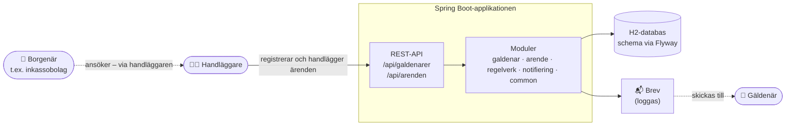

---

## 2. Moduler och beroenden

Varje modul är ett paket. Det som ligger **direkt i modulens paket** är dess publika API;
allt i underpaketen (`web`, `service`, `domain` …) är internt. Pilarna visar vem som **får**
anropa vem – Spring Modulith kontrollerar det i `ModulStrukturTest`.

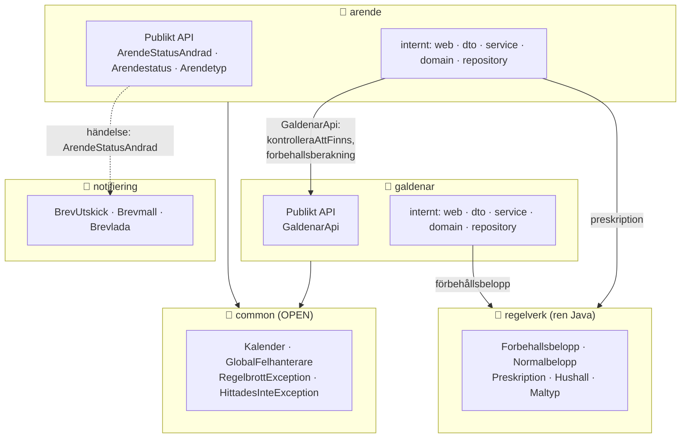

---

## 3. Lagren i ett anrop

Varje modul är uppdelad i samma lager. Pilarna är de **enda** tillåtna beroendena –
`LagerArkitekturTest` (ArchUnit) underkänner bygget om någon bryter mot dem.

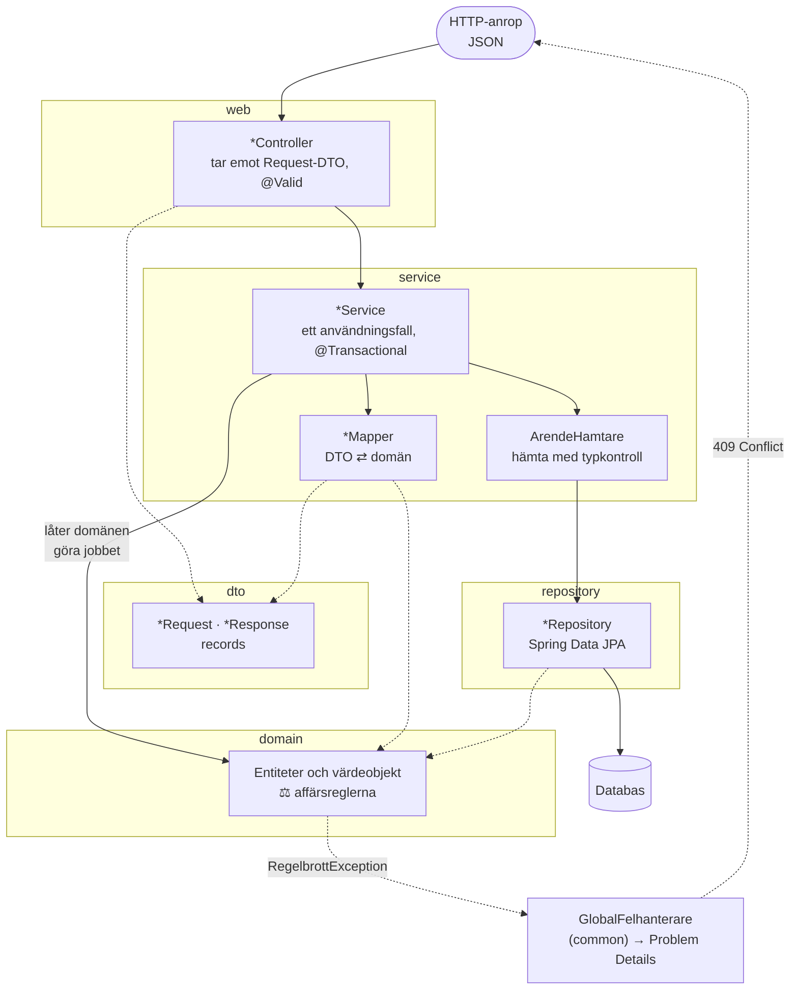

| Lager | Får använda | Får inte använda |
|---|---|---|
| `web` | `service`, `dto` | `repository`, `domain` |
| `service` | `repository`, `domain`, `dto`, andra modulers API | `web` |
| `repository` | `domain` | `service`, `web`, `dto` |
| `domain` | `regelverk`, `common` | alla lager ovan |
| `dto` | – | alla lager |

---

## 4. Processkedjan: från krav till betald skuld

Hur de tre ärendetyperna hänger ihop i verkligheten. Ett utslag i ett betalningsföreläggande
kan bli ett **nytt** utsökningsärende (`ursprungsarendeId` pekar tillbaka).

---

## 5. Statusflöden

Varje ärendeklass har en konstant `FLODE` (`Statusflode`) med exakt dessa övergångar.
Allt annat avvisas med 409.

### Betalningsföreläggande

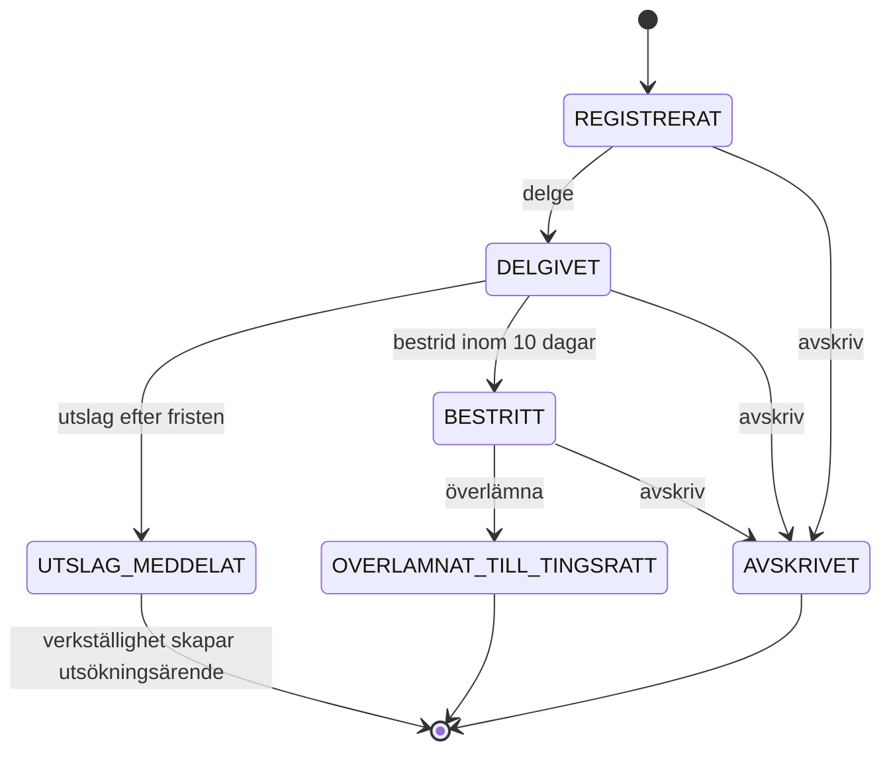

### Utsökning

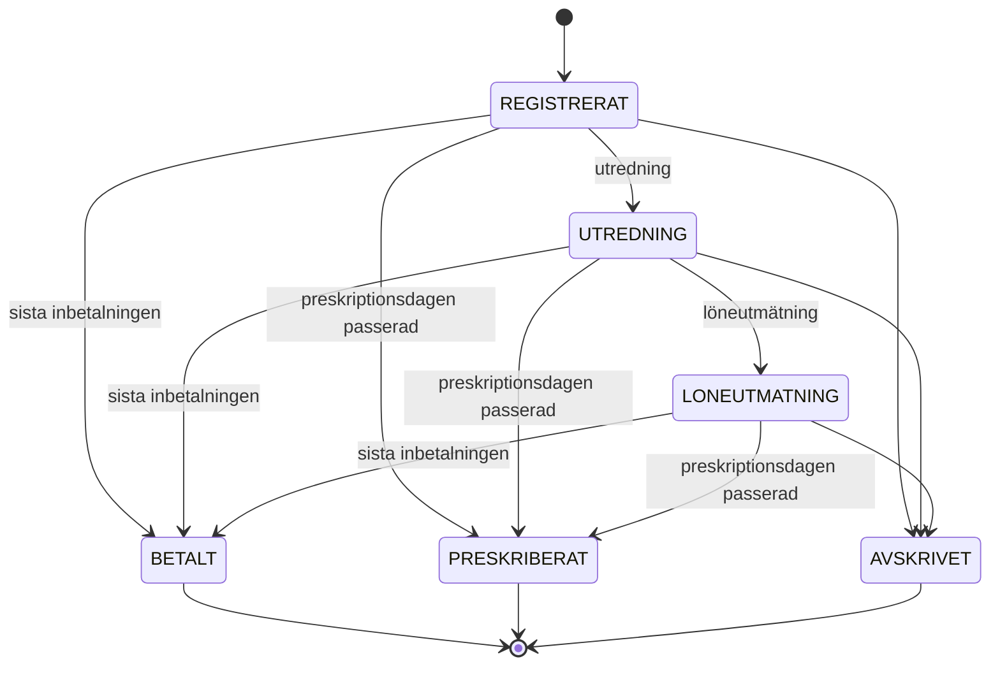

### Skuldsanering

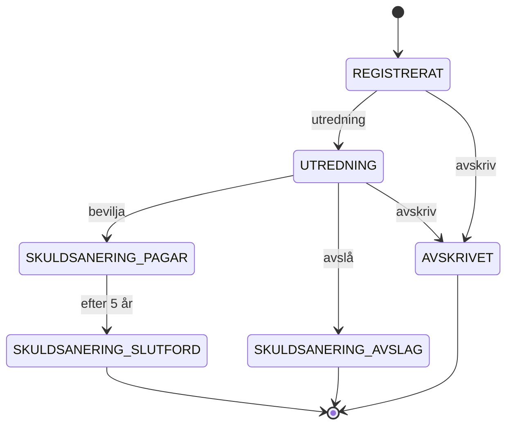

---

## 6. Klassdiagram: ärenden

Basklassen har det gemensamma. Varje subklass har reglerna för sin process.
Små värdeobjekt bär var sin regel.

---

## 7. Klassdiagram: ärendemodulens lager

En controller och en service per process. Alla services delar på `ArendeHamtare` (hämta/spara via
repository) och `ArendeMapper` (DTO ⇄ domän). Gäldenärsmodulen nås bara via `GaldenarApi`.

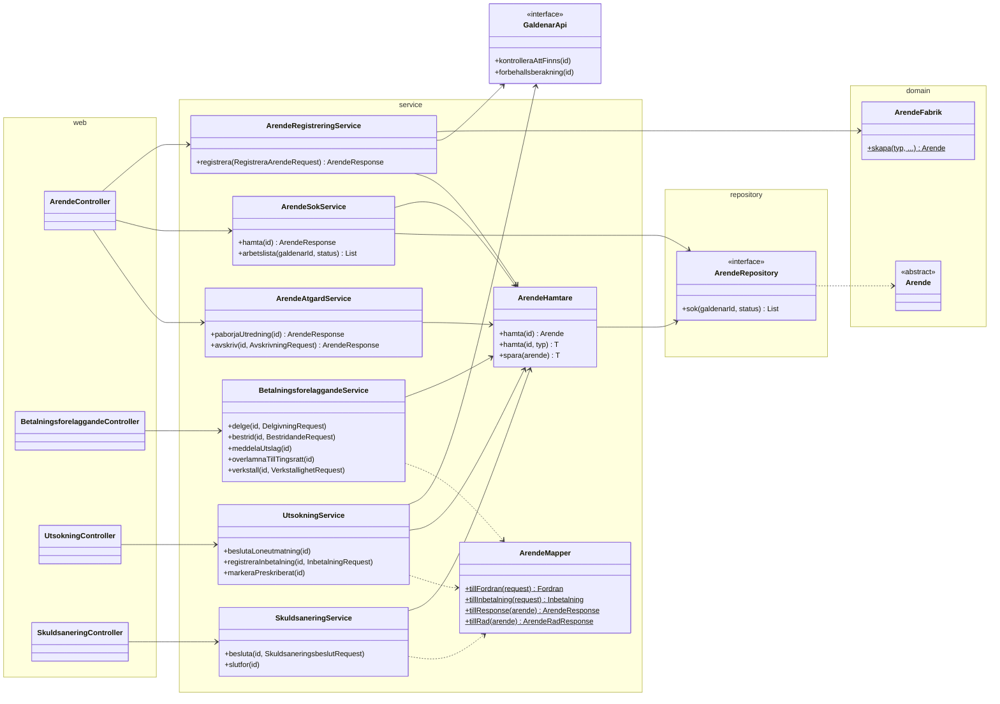

---

## 8. Klassdiagram: gäldenär, regelverk och notifiering

`GaldenarApi` ligger direkt i modulens paket och är det enda andra moduler ser.

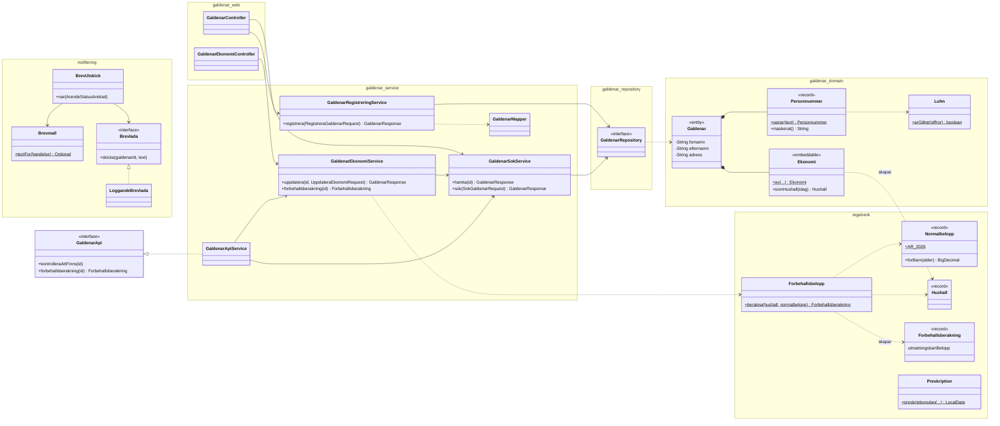

---

## 9. Sekvens: delgivning och brev

Vad händer när handläggaren registrerar en delgivning? Notera att brevet skickas
**efter** att transaktionen committats, på en annan tråd.

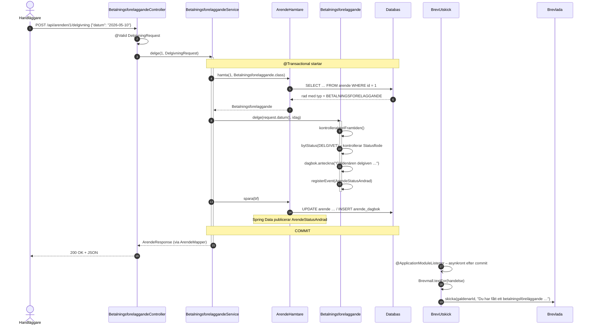

### Om en regel bryts

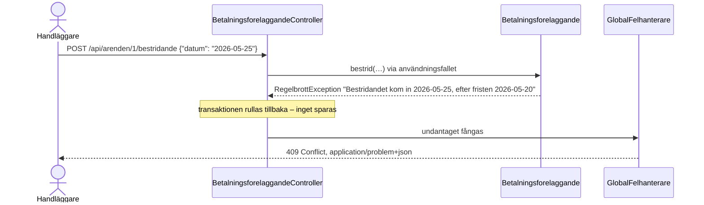

---

## 10. Sekvens: löneutmätning över modulgränsen

Ärendemodulen frågar gäldenärsmodulen, som frågar regelverket. Ingen modul rör en annan
moduls entiteter eller services – bara dess publika API (`GaldenarApi`).

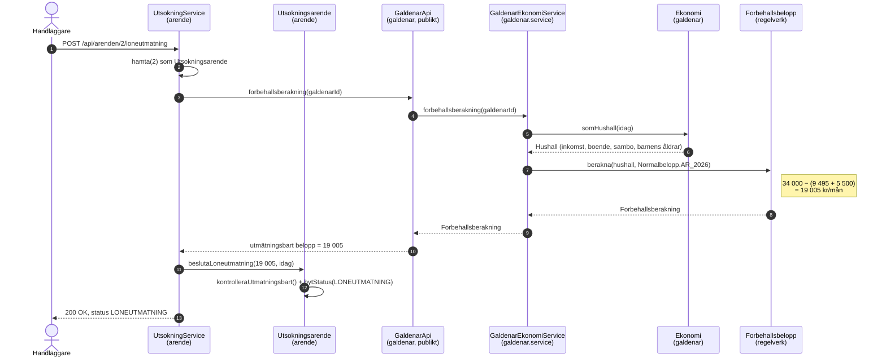

---

## 11. Databas

Tabellerna skapas av Flyway (`V1__schema.sql`). Alla tre ärendetyper ligger i **samma tabell**
`arende`; kolumnen `typ` avgör vilken Java-klass raden blir (JPA `SINGLE_TABLE`).
Det finns ingen foreign key mellan `arende` och `galdenar` – modulerna äger sina egna tabeller.

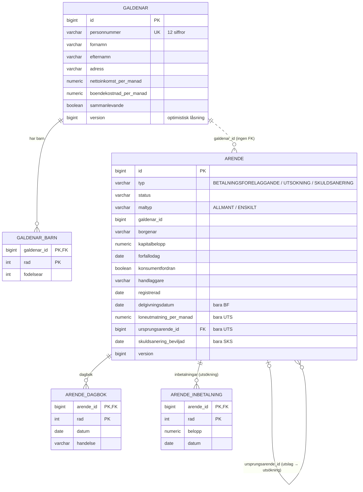

---

> Spring Modulith genererar dessutom egna PlantUML-diagram över modulerna när testerna körs:
> `target/spring-modulith-docs/components.puml` (se `ModulStrukturTest`).
