# Diagram – så hänger allt ihop

Diagrammen är skrivna i [Mermaid](https://mermaid.js.org) och visas direkt på GitHub och i
IntelliJ/VS Code (med Mermaid-tillägg). Läs dem uppifrån och ned: från helheten till detaljerna.

1. [Helhetsbild](#1-helhetsbild)
2. [Tjänster och hur de pratar](#2-tjänster-och-hur-de-pratar)
3. [Lagren i ett anrop](#3-lagren-i-ett-anrop)
4. [Processkedjan: från krav till betald skuld](#4-processkedjan-från-krav-till-betald-skuld)
5. [Statusflöden](#5-statusflöden)
6. [Klassdiagram: ärenden](#6-klassdiagram-ärenden)
7. [Klassdiagram: ärendetjänstens lager](#7-klassdiagram-ärendetjänstens-lager)
8. [Klassdiagram: gäldenärstjänsten och notifieringstjänsten](#8-klassdiagram-gäldenärstjänsten-och-notifieringstjänsten)
9. [Sekvens: delgivning och brev via Kafka](#9-sekvens-delgivning-och-brev-via-kafka)
10. [Sekvens: löneutmätning över tjänstegränsen](#10-sekvens-löneutmätning-över-tjänstegränsen)
11. [Databaser](#11-databaser)

---

## 1. Helhetsbild

Vem använder systemet, och vad finns innanför?

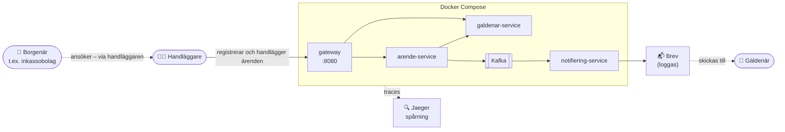

---

## 2. Tjänster och hur de pratar

Fyra fristående tjänster. Heldragna pilar är **synkrona** HTTP-anrop (svaret behövs direkt).
Den streckade vägen via Kafka är **asynkron**: ärendetjänsten vet inte vem som lyssnar.

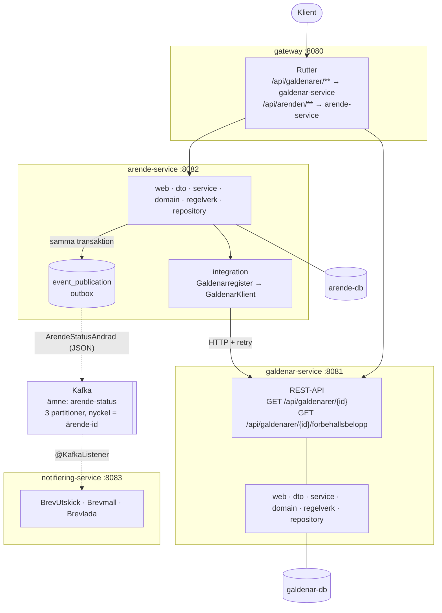

| Tjänst | Databas | Tar emot | Skickar |
|---|---|---|---|
| `gateway` | – | alla klientanrop | vidare till rätt tjänst |
| `galdenar-service` | `galdenar-db` | REST | – |
| `arende-service` | `arende-db` | REST | REST till gäldenärstjänsten, händelser till Kafka |
| `notifiering-service` | – | händelser från Kafka | brev |

---

## 3. Lagren i ett anrop

Ärende- och gäldenärstjänsten är uppdelade i samma lager. Pilarna är de **enda** tillåtna
beroendena – `LagerArkitekturTest` (ArchUnit) underkänner bygget om någon bryter mot dem.

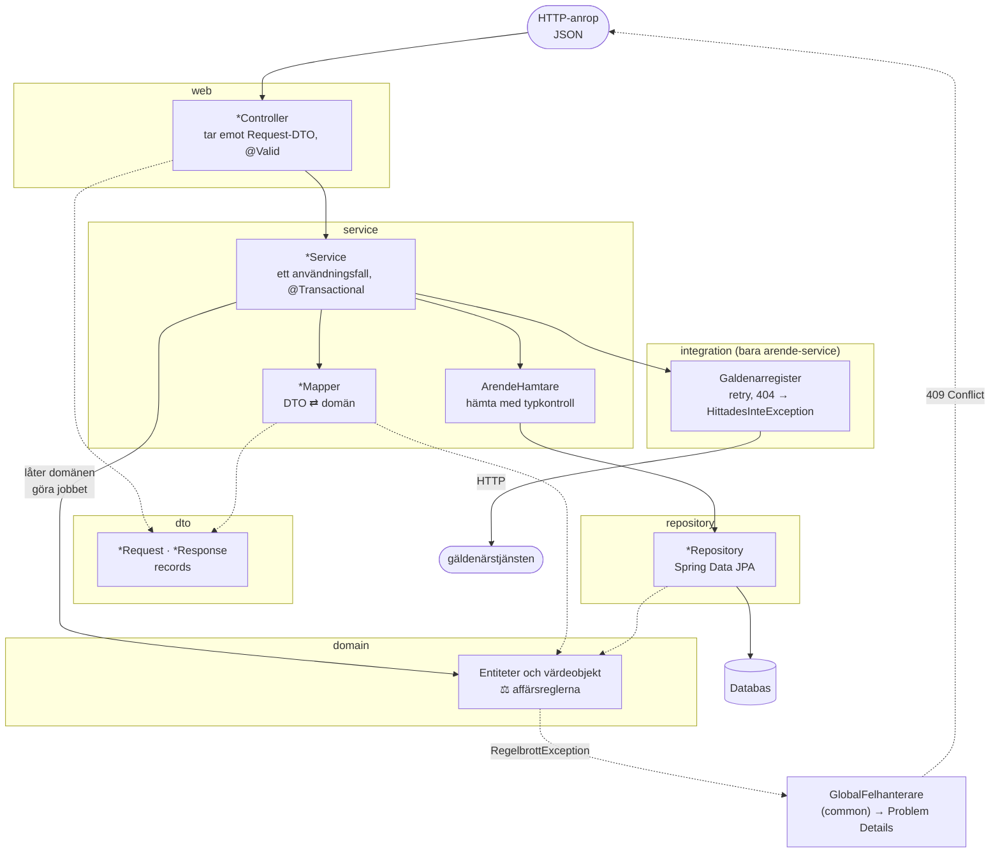

| Lager | Får använda | Får inte använda |
|---|---|---|
| `web` | `service`, `dto` | `repository`, `domain` |
| `service` | `repository`, `domain`, `dto`, `integration` | `web` |
| `repository` | `domain` | `service`, `web`, `dto` |
| `domain` | `regelverk`, `common` | alla lager ovan |
| `integration` | – | används bara av `service` |
| `regelverk` | inget annat lager | – |
| `dto` | `regelverk` | alla lager |

---

## 4. Processkedjan: från krav till betald skuld

Hur de tre ärendetyperna hänger ihop i verkligheten. Ett utslag i ett betalningsföreläggande
kan bli ett **nytt** utsökningsärende (`ursprungsarendeId` pekar tillbaka).

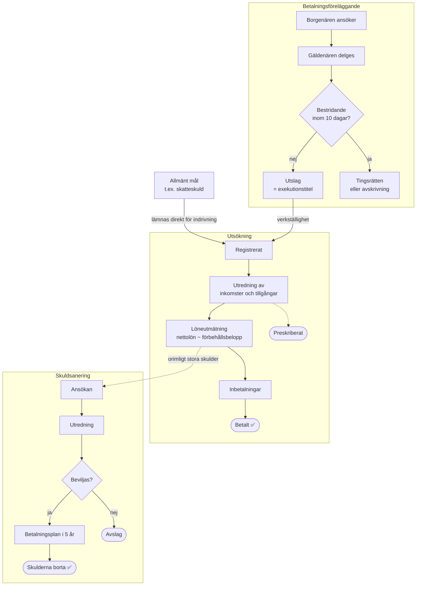

---

## 5. Statusflöden

Varje ärendeklass har en konstant `FLODE` (`Statusflode`) med exakt dessa övergångar.
Allt annat avvisas med 409.

### Betalningsföreläggande

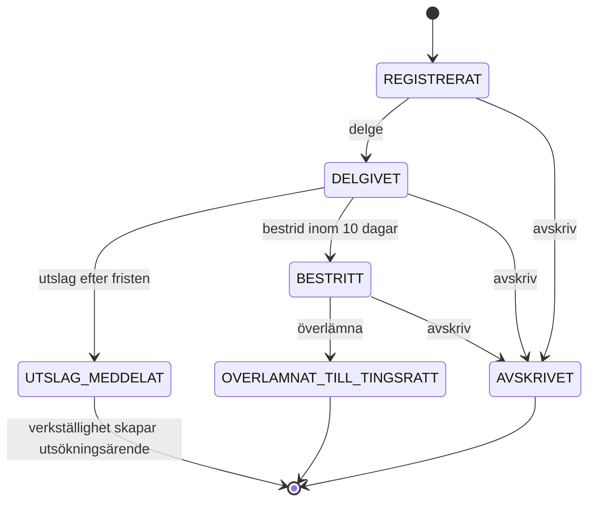

### Utsökning

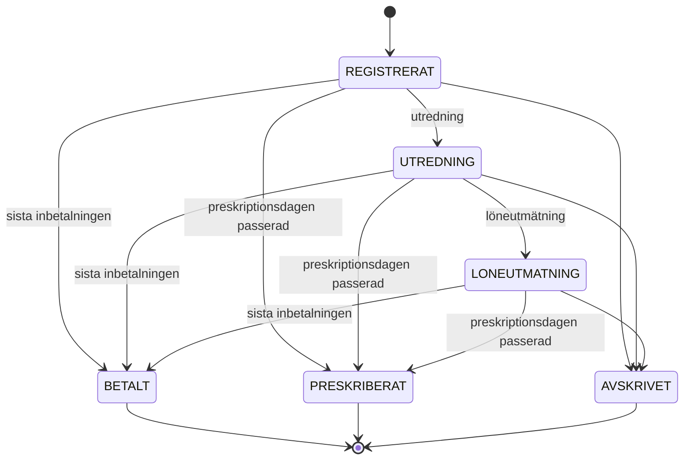

### Skuldsanering

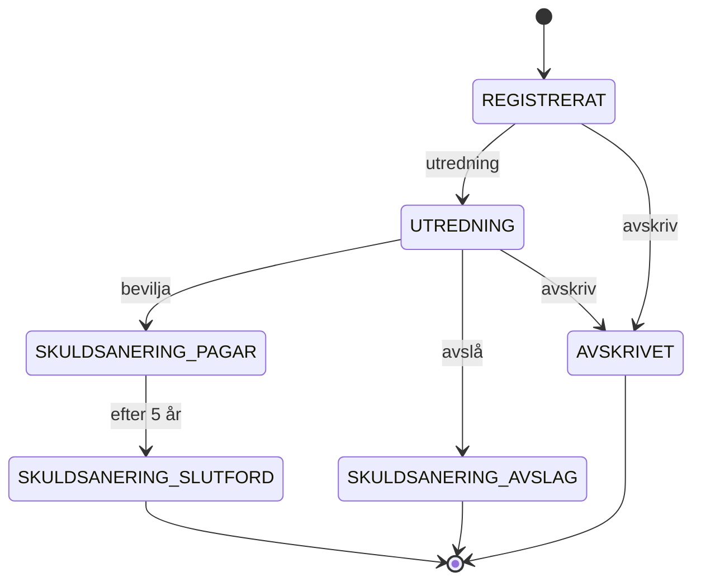

---

## 6. Klassdiagram: ärenden

Basklassen har det gemensamma. Varje subklass har reglerna för sin process.
Små värdeobjekt bär var sin regel.

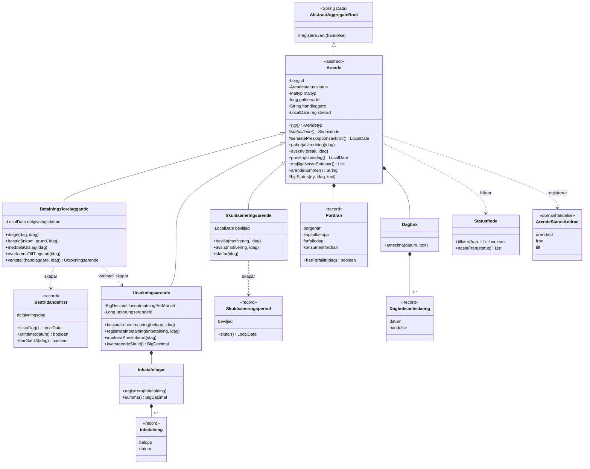

---

## 7. Klassdiagram: ärendetjänstens lager

En controller och en service per process. Alla services delar på `ArendeHamtare` (hämta/spara via
repository) och `ArendeMapper` (DTO ⇄ domän). Gäldenärstjänsten nås bara via `Galdenarregister`.

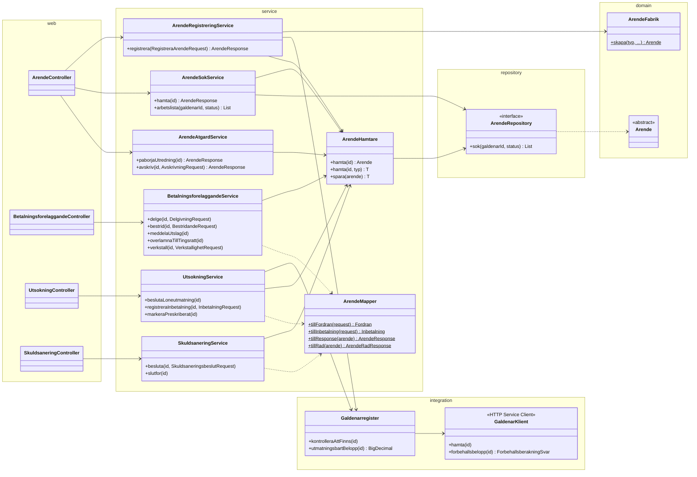

---

## 8. Klassdiagram: gäldenärstjänsten och notifieringstjänsten

Två separata tjänster i samma bild. Gäldenärstjänsten har inget Java-API för andra – bara REST.
Notifieringstjänsten har sin egen kopia av `ArendeStatusAndrad` och delar bara JSON-formatet
med ärendetjänsten.

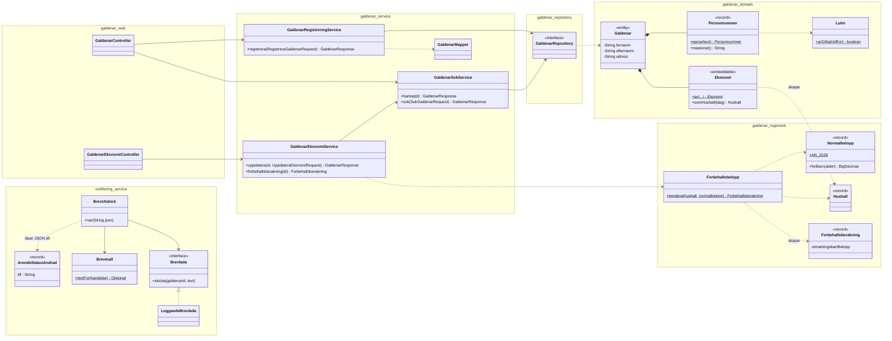

---

## 9. Sekvens: delgivning och brev via Kafka

Vad händer när handläggaren registrerar en delgivning? Händelsen sparas i **samma transaktion**
som ärendet (outbox). Först efter commit skickas den till Kafka, och notifieringstjänsten tar
emot den i sin egen takt.

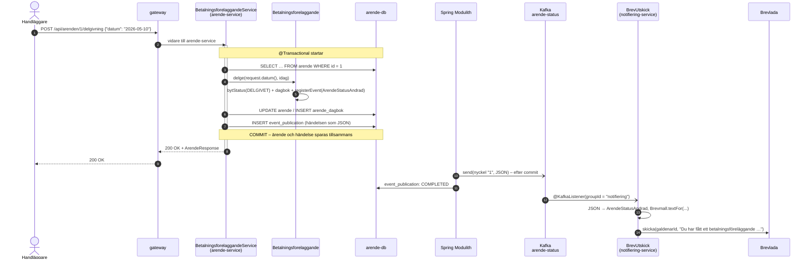

Är Kafka nere ligger händelsen kvar i `event_publication` och skickas när ärendetjänsten startar
om. Är notifieringstjänsten nere väntar meddelandet i Kafka tills den är uppe igen.

### Om en regel bryts

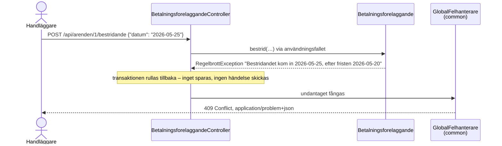

---

## 10. Sekvens: löneutmätning över tjänstegränsen

Ärendetjänsten frågar gäldenärstjänsten över HTTP. Service-lagret vet inte om det – det anropar
bara `Galdenarregister`. Nätverket, retry och felöversättning ligger i `integration`.

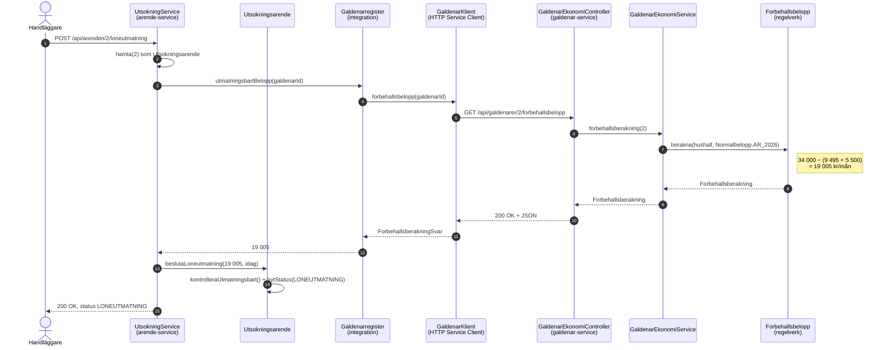

### Om gäldenärstjänsten inte svarar

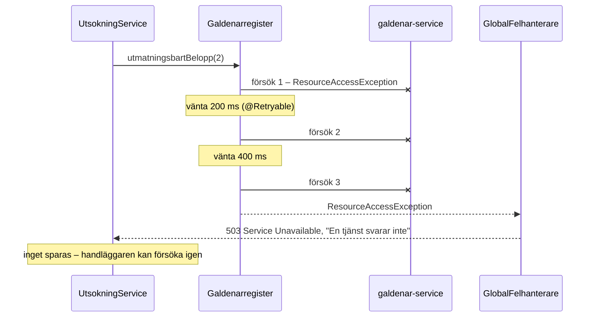

Svarar gäldenärstjänsten **404** görs inget nytt försök. `Galdenarregister` gör om det till
`HittadesInteException`, och ärendetjänsten svarar också 404.

---

## 11. Databaser

Varje tjänst har en **egen databas** med egna Flyway-migreringar (`db/migration/galdenar` och
`db/migration/arende`). Ärendet har bara gäldenärens id – ingen foreign key, eftersom gäldenären
finns i en annan databas. Alla tre ärendetyper ligger i **samma tabell** `arende`; kolumnen `typ`
avgör vilken Java-klass raden blir (JPA `SINGLE_TABLE`).

`event_publication` är outbox-tabellen. Spring Modulith skapar den och sparar varje händelse där
innan den skickas till Kafka.

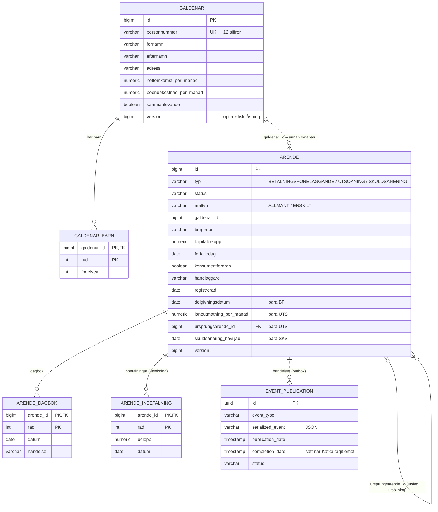

| Databas | Tabeller |
|---|---|
| `galdenar-db` | `galdenar`, `galdenar_barn` |
| `arende-db` | `arende`, `arende_dagbok`, `arende_inbetalning`, `event_publication` |
